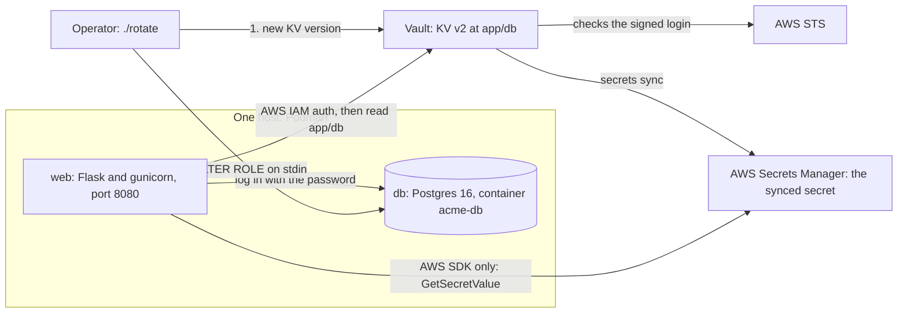

# Acme Orders

Acme Orders is a small order-dispatch web app that uses a real database password. It reads that password from HashiCorp Vault and uses it to open a Postgres database. It is a demo app for KV version 2 and Vault secrets sync to AWS Secrets Manager.

It shows three things on one page:

- A password change in Vault reaches the app with no redeploy. The page checks every 5 seconds.
- An old KV version is still readable in Vault, but the database refuses it after a rotation.
- Vault secrets sync copies each new version to AWS Secrets Manager. A reader that only knows AWS gets the same password.

The page never shows a full password. Every response shows its first 8 characters and a row of dots. A password of 8 characters or fewer shows as dots only.

## Architecture



The page has two readers of the same password:

| Reader | Reads from | Identity | What the page shows |
|---|---|---|---|
| Web front end | Vault KV v2, mount `app`, secret `db` | AWS IAM auth in Vault, with the host's IAM role. The host holds no Vault secret. | The version list, the masked password, when the version was created, and whether the database accepts it |
| Nightly report job | AWS Secrets Manager, the secret named in `KVS_AWS_SECRET_NAME` | The same IAM role, through the AWS SDK only, with no Vault client | When the secret last changed, which Vault version it matches, and whether the database accepts it |

The report job is a panel in the same web process. Its read from AWS uses boto3 only. To say which Vault version the AWS copy matches, the app compares it with the versions it reads from Vault.

A third panel, "Today's orders", lists the orders from the database. The orders query is the database login, so the list empties and says why when the database refuses the password.

## Endpoints

| Endpoint | Returns |
|---|---|
| `GET /` | The page. It calls the JSON endpoints every 5 seconds. |
| `GET /api/secret` | The Vault reader, for the latest version. Fields: `source`, `state`, `version`, `latest`, `masked`, `changed`, `message`, `db_login` (`accepted`, `refused`, or `null`), and `versions` (each version with its created time and `live`, `deleted`, or `destroyed`). |
| `GET /api/secret?version=N` | The same, for version N. N is a whole number from 1. Anything else returns 400. A version that Vault does not have returns 404. |
| `GET /api/secret?source=aws` | The AWS reader. Same fields, without `versions`. |
| `GET /api/orders` | Today's orders, read with the latest password from Vault. Fields: `orders`, `password_version`, `db_login`, `state`, `message`, and `cached`. |
| `GET /api/orders?version=N` | The same, with the password of version N. |
| `GET /healthz` | `{"ok": true}` when the process is up. It does not call Vault or the database. |

Errors return JSON with `error` and `message`. An unexpected error returns a generic 500 and logs only the exception type and the path, never the exception text.

## States

Each response has a `state` and a `message` in plain words. These are the messages the web layer returns.

**Web front end (Vault)**

| State | Message |
|---|---|
| `ok` | Database login with v3: accepted |
| `refused` | For the latest version: "Database login with v3: refused. The database does not accept this password." For an older version: "Database login with v1: refused. Version 1 is still readable in Vault, but the database user now has the v3 password. Rotate both together." |
| `deleted` | Version 2 was deleted in Vault |
| `destroyed` | Version 1 was destroyed in Vault |
| `gone` | With no `app/db` in Vault: "No password in Vault yet at app/db. Run rotate to create one. If it was there before, its metadata was removed." The same message, with status 404, for `?version=N` after the metadata was removed. For a version that Vault does not have: "Vault has no version 9". For a version that Vault no longer keeps, because it is older than the `max_versions` most recent versions: "Vault no longer keeps version 1". Both return status 404. |
| `login_failed` | Vault login failed |
| `unreachable` | "Cannot reach Vault", "Cannot read from Vault", or "Cannot reach the database" |
| `not_configured` | Vault is not configured (`VAULT_ADDR` is not set) |

**Report job (AWS Secrets Manager)**

| State | Message |
|---|---|
| `ok` | AWS matches Vault v3. Database login: accepted |
| `refused` | The same first sentence, then "Database login: refused" |
| `waiting` | Waiting for sync (AWS has v2, Vault has v3) |
| `gone` | Not in AWS Secrets Manager |
| `deleted` | Marked for deletion in AWS Secrets Manager |
| `login_failed` | AWS access denied |
| `unreachable` | "Cannot reach AWS Secrets Manager", "Cannot read from AWS Secrets Manager", or "Cannot reach the database" |
| `not_configured` | With no `KVS_AWS_SECRET_NAME`: "Secrets sync is not set up yet, so there is no AWS secret to read." With the name set, but no Secrets Manager client (for example, no region): "AWS Secrets Manager is not configured". With a secret that is not JSON with `username` and `password`: "The AWS secret is not JSON with username and password" |

When the AWS copy matches no live Vault version, the first sentence is "The AWS password does not match a readable Vault version". When the app cannot read Vault, it is "Cannot compare with Vault right now".

**Orders when Vault is down**

The app keeps the last good latest password from Vault in process memory. It never logs it and never returns it. If Vault cannot be reached, or refuses the login, `/api/orders` uses that password and sets `cached` to `true`. The message then says so, for example "Cannot reach Vault. Using the last good password from Vault, v3. Database login with v3: accepted".

Every call to Vault and to AWS has a short timeout, so a service that hangs, rather than refusing the connection, cannot hold a worker. Each Vault request may take 5 seconds (`KVS_VAULT_TIMEOUT`). The Secrets Manager client connects within 3 seconds, reads within 5 seconds, and makes at most 2 attempts. A Vault request that times out reads as `unreachable`, "Cannot reach Vault", the same as a refused connection.

Each gunicorn worker keeps its own last good password. The container runs two workers. A worker that has not had a good read yet has nothing to fall back on. During an outage it returns the Vault error, with `cached` set to `false`.

## How it tells a refused password from a database outage

The app opens the database with the password it read, with a 3 second connect timeout. Then it sorts the result:

- **Refused.** Postgres returns SQLSTATE `28P01` (wrong password) or `28000` (invalid authorisation, for example no matching `pg_hba.conf` rule). A failure during the connection has no SQLSTATE, so the app also reads the client message for "password authentication failed" or "no pg_hba.conf entry". The state is `refused`.
- **Cannot reach the database.** Any other failure, such as a timeout, a refused connection, or a host name that does not resolve. The state is `unreachable` and the message is "Cannot reach the database".

So a stopped database never reads as a wrong password, and a wrong password never reads as an outage.

## How it logs in to Vault

The web front end uses the AWS auth method, IAM type, at mount `aws` with role `acme-orders`.

1. boto3 finds the host's AWS credentials, for example the EC2 instance role.
2. hvac signs an STS `GetCallerIdentity` request with them. It adds the header `X-Vault-AWS-IAM-Server-ID` when `KVS_IAM_SERVER_ID` is set. The request is signed for `us-east-1`, because hvac targets the global STS endpoint. Set `KVS_IAM_STS_REGION` to change that.
3. Vault checks the signed request with AWS and returns a token with the role's policy.

The client is cached. The app renews the token 60 seconds before it expires, and logs in again when it cannot renew. After any Vault error, it drops the cached client, so the next check starts with a fresh login.

The app needs read on two paths and nothing else:

```hcl
path "app/data/db" {
  capabilities = ["read"]
}

path "app/metadata/db" {
  capabilities = ["read"]
}
```

## Configuration

The web front end reads these environment variables.

| Variable | Default | Purpose |
|---|---|---|
| `VAULT_ADDR` | none | Vault address. When it is not set, the Vault panel shows `not_configured`. |
| `VAULT_NAMESPACE` | none | Vault namespace, for example `admin/<your namespace>` on HCP Vault Dedicated |
| `KVS_IAM_SERVER_ID` | none | Value of the `X-Vault-AWS-IAM-Server-ID` header. Match `iam_server_id_header_value` on `auth/aws/config/client`. |
| `KVS_IAM_STS_REGION` | `us-east-1` | Region the IAM login request is signed for |
| `KVS_VAULT_TIMEOUT` | `5` | Seconds each Vault request may take before the app reports "Cannot reach Vault". A value that is not a positive number uses the default. |
| `AWS_REGION` | none | Region of the Secrets Manager client |
| `KVS_AWS_SECRET_NAME` | none | Name of the synced secret in AWS Secrets Manager. When it is not set, the AWS panel says sync is not set up yet. |
| `KVS_DB_HOST` | `db` | Postgres host |
| `KVS_DB_PORT` | `5432` | Postgres port |
| `KVS_DB_NAME` | `acme` | Postgres database |
| `KVS_DEV_VAULT_TOKEN_FILE` | none | **Local development only.** Reads a Vault token from this file instead of using AWS IAM auth. Never set it on a shared or production host. |

The KV path is fixed: mount `app`, secret `db`, with the keys `username` and `password`. AWS credentials come from the standard AWS SDK chain.

## What `rotate` does

`rotate` changes the database password in Vault and on the database user in one step. It prints the new KV version number on stdout.

1. **Password.** It reads the first line of stdin, which must have at least 20 characters. With no password on stdin, it makes one with `openssl rand -base64 18`.
2. **Pre-flight.** It sends `SELECT 1` to the database through the database command. If that fails, it stops with exit code 3 and changes nothing.
3. **Vault first.** On the first run it creates `app/db` with `vault kv put` and the username `acme`. After that it adds a version with `vault kv patch`.
4. **Then the database.** It sends `ALTER ROLE acme WITH PASSWORD '...'` to `psql`. The SQL starts with `SET log_min_error_statement = panic`, so a failed statement does not write the password to the Postgres log.

Vault goes first because Vault is the source of truth. If the Vault write fails, nothing has changed and the app keeps working. If the database step fails, Vault already holds the password that the database needs. `rotate` says so, exits with code 1, and the next run sets both. If the database changed first and the Vault write then failed, the database would hold a password that no reader could get.

The password never goes on a command line. `vault` and `psql` both read it on stdin.

**The database command.** `KVS_DB_EXEC` is the command that runs `psql` in the database container, with the SQL on its stdin. The default is `podman exec -i acme-db` (`KVS_DB_CONTAINER` changes the name). From a workstation, run the same command on the app host over SSH, so the operator token stays on the workstation:

```sh
KVS_DB_EXEC="ssh ec2-user@<app host> sudo podman exec -i acme-db" ./rotate
```

`rotate` splits `KVS_DB_EXEC` into words on spaces and tabs only. It never passes the value to a local shell, so there is no glob expansion and no command substitution. When the first word is `ssh`, ssh joins the other words and the `psql` arguments into one line, and the remote shell parses that line. So put only fixed flags and names in `KVS_DB_EXEC`, never a secret or a word that needs quoting. The password and the SQL always go on stdin.

`rotate` needs the `vault` CLI, logged in with an operator token (`VAULT_ADDR`, `VAULT_TOKEN`, and `VAULT_NAMESPACE` as usual), and `openssl`. It works with bash 3.2 and later.

## Run it locally with Podman and a dev-mode Vault

> **Development only.** A dev-mode Vault keeps everything in memory, starts unsealed, and uses a root token. Use it on your own machine to try the app. Never use it for real secrets.

Locally there is no AWS IAM role, so the web front end reads a dev token from a file instead. The AWS panel says that sync is not set up, because there is no AWS secret to read.

You need Podman with `podman compose`, the `vault` CLI, `openssl`, `curl`, and `jq`. These steps were run with Podman 6.1 on macOS, where `podman compose` used Docker Compose as its provider. Run them all in one terminal, from the root of this repository.

1. Clear any Vault settings from your shell, then make a throwaway dev token in a file only you can read. `compose.yaml` passes `VAULT_NAMESPACE` from your shell to the web front end, and a dev-mode Vault has no namespaces.

   ```sh
   unset VAULT_ADDR VAULT_TOKEN VAULT_NAMESPACE
   (umask 077; openssl rand -hex 16 > ~/.acme-orders-dev-token)
   export ACME_DEV_TOKEN=$(cat ~/.acme-orders-dev-token)
   ```

   Assumption, not tested: with rootless Podman on Linux, the web container's non-root user may not be able to read a 0600 file. If the Vault panel then says "Cannot read from Vault", make the file readable with `chmod 644`. It holds a throwaway dev token only.

2. Save this as `compose.dev.yaml` next to `compose.yaml`. It adds a dev-mode Vault and points the web front end at it.

   ```yaml
   # Development only: a dev-mode Vault, and the web front end reads a dev token.
   services:
     vault:
       image: docker.io/hashicorp/vault:1.21
       environment:
         VAULT_DEV_ROOT_TOKEN_ID: ${ACME_DEV_TOKEN:?set ACME_DEV_TOKEN}
       ports:
         - "127.0.0.1:8200:8200"
     web:
       environment:
         VAULT_ADDR: http://vault:8200
         KVS_DEV_VAULT_TOKEN_FILE: /run/acme/dev-token
       volumes:
         - ${HOME}/.acme-orders-dev-token:/run/acme/dev-token:ro,Z
       depends_on:
         - db
         - vault
   ```

3. Start the app, the database, and Vault.

   ```sh
   podman compose -f compose.yaml -f compose.dev.yaml up -d --build
   ```

4. Enable KV version 2 at `app`, then write the first password. `rotate` creates `app/db` and sets the same password on the database user.

   ```sh
   export VAULT_ADDR=http://127.0.0.1:8200 VAULT_TOKEN=$ACME_DEV_TOKEN
   vault secrets enable -path=app kv-v2
   ./rotate
   ```

   `rotate` prints `rotate: app/db is now at version 1 and the database user has its password.` and then `1`. If it says it cannot reach the database, Postgres is still starting. Wait a few seconds and run it again.

5. Open <http://localhost:8080>. Within 5 seconds the orders appear and the Vault panel says "Database login with v1: accepted".

6. Try it:
   - Run `./rotate` again. The page moves to v2 with no restart.
   - Click the v1 tab. Vault still returns v1, but the database refuses it, and the orders list says why.
   - Run `vault kv delete -versions=1 app/db`. The v1 tab says Deleted. Then run `vault kv destroy -versions=1 app/db`, and it says Destroyed.
   - Run `podman stop acme-db`. The Vault panel and the orders list say "Cannot reach the database", not "refused". Run `podman start acme-db` to bring it back.
   - Read the JSON, for example `curl -s http://localhost:8080/api/secret | jq -c '{state, version, message}'`.

7. Stop and remove everything, including the database volume. Run this in the same terminal, because `compose.dev.yaml` needs `ACME_DEV_TOKEN` set. The image `localhost/acme-orders:latest` stays; remove it with `podman rmi` if you want.

   ```sh
   podman compose -f compose.yaml -f compose.dev.yaml down -v
   rm ~/.acme-orders-dev-token
   ```

## Run it against HCP Vault Dedicated and AWS

The companion guide builds this end to end. It sets up an EC2 instance that runs the app, AWS IAM auth in Vault, the read-only policy, and secrets sync to AWS Secrets Manager. See [the HCP Vault KV v2 and secrets sync PoC guide](https://hcp-vault-aws-kv-sync.vercel.app).

In short:

1. In Vault, enable KV version 2 at `app` and write the policy above, for example as `acme-orders-read`. Enable the AWS auth method at `aws`.
2. Optional but recommended: require the Vault host name in every login. Use the same value for `KVS_IAM_SERVER_ID`.

   ```sh
   vault write auth/aws/config/client iam_server_id_header_value=<vault host>
   ```

3. Create the role `acme-orders`, bound to the host's IAM role. Keep `resolve_aws_unique_ids=false` on HCP Vault Dedicated. With the default, `true`, Vault looks up the role in AWS with its own AWS identity. That identity is not in your account, so the role write fails.

   ```sh
   vault write auth/aws/role/acme-orders auth_type=iam \
     bound_iam_principal_arn=<host IAM role ARN> resolve_aws_unique_ids=false \
     token_policies=acme-orders-read token_ttl=1h
   ```

4. Give the host's IAM role `secretsmanager:GetSecretValue` on the synced secret. The app calls nothing else in AWS.
5. On EC2, the containers reach the instance metadata service through one extra network hop. With IMDSv2, set the instance's metadata hop limit to 2 or more.
6. Set `VAULT_ADDR`, `VAULT_NAMESPACE`, `AWS_REGION`, `KVS_IAM_SERVER_ID`, and `KVS_AWS_SECRET_NAME` in the environment, or in a git-ignored `.env` next to `compose.yaml`, and run `podman compose up -d --build`.
7. Run `./rotate` with an operator token to write the first password.

## Tests

The unit tests use fakes only. They need no network, Vault, AWS, or Postgres.

```sh
python3 -m venv .venv
.venv/bin/pip install -r requirements.txt
.venv/bin/python -m pytest
bash tests/test_rotate.sh
node --test tests/
```

- `pytest` covers the web layer, both readers, the Vault login, and that no response holds a full password.
- `tests/test_rotate.sh` runs `rotate` with fake `vault`, `podman`, and `ssh` commands. It checks that the password goes on stdin only, that the pre-flight stops before Vault changes, and that `KVS_DB_EXEC` is never evaluated by a shell.
- `node --test tests/` checks the text that the AWS panel shows, and the labels on the version tabs. The latest tab says Latest, or Deleted or Destroyed when the latest version is. It needs Node.js and no packages. It was last run with Node.js 26.

`tests/test_db_real.py` runs against a real Postgres and is skipped by default. To run it, set `KVS_PG_TEST=1` and `KVS_PG_PASSWORD`, with Postgres on `KVS_DB_HOST` and `KVS_DB_PORT` (default `127.0.0.1:55432`).

## Licence

Acme Orders is licensed under the Mozilla Public License 2.0 (MPL-2.0). See [LICENSE](LICENSE).

The bundled font, Schibsted Grotesk, is licensed under the SIL Open Font License 1.1. See [acme/static/fonts/OFL.txt](acme/static/fonts/OFL.txt).

The orders in `seed.sql` are fictional.
